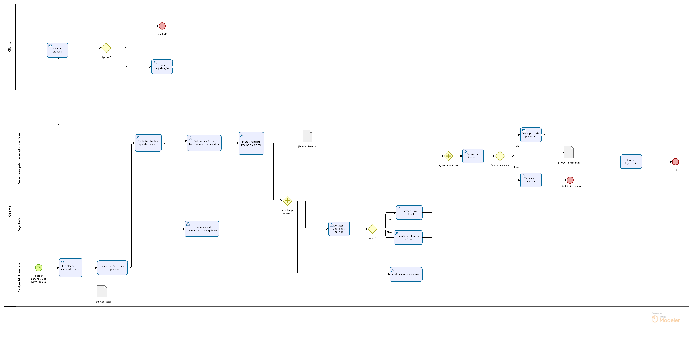

# 📊 Business Process Modeling

**Modelação de processos de negócio e estratégia organizacional**
BPMN · OML · Sistemas de Informação

---

## 📖 Sobre o projeto

Este repositório reúne o trabalho de modelação de processos de negócio e
análise organizacional desenvolvido no âmbito de **[Estratégia Organizacional /
Licenciatura em Engenharia Informática]**.

O objetivo foi **[descrever em 1-2 frases o problema/organização estudada, ex.:
modelar e otimizar os processos de uma organização fictícia/real]**, usando
notações padrão da indústria para representar processos, regras e
relações entre as várias partes do negócio.

> 🎯 **Porque é relevante:** a modelação de processos é a base da
> implementação de sistemas ERP (como o SAP) e da análise de dados
> orientada ao negócio.

---

## 🗂️ Conteúdo

| Pasta | Descrição |
|---|---|
| [`relatorio/`](./report) | Relatório completo com enquadramento, análise e conclusões |
| [`modelos-oml/`](./models-oml) | Modelos em OML (`.oml`) |
| [`processos-bpmn/`](./processs-bpmn) | Processos em BPMN 2.0 (`.bpmn`) |
| [`diagramas/`](./diagrams) | Exportações visuais dos modelos (`.png`) |

---

## 🖼️ Exemplo de diagrama

<!-- Substitui pelo nome real de um dos teus PNG -->

*[Legenda curta: o que este processo representa]*

---

## 🧩 Principais modelos

1. **[Nome do processo 1]**: [uma linha sobre o que modela]
2. **[Nome do processo 2]**: [uma linha sobre o que modela]
3. **[Nome do processo 3]**: [uma linha sobre o que modela]

---

## 🛠️ Ferramentas e tecnologias

- **Notações:** BPMN 2.0, OML
- **Ferramentas:** `OutSystems`
- **Documentação:** `Word`

---

## ▶️ Como abrir os ficheiros

- **`.bpmn`:** abrir em [bpmn.io](https://demo.bpmn.io/) ou [Camunda Modeler](https://camunda.com/download/modeler/)
- **`.oml`:** abrir em `OutSystems`
- **Relatório:** ficheiro PDF em [`relatorio/`](./relatorio)

---

## 👤 Autor

**Daniel Duarte Silva**
Estudante de Engenharia Informática (Sistemas de Informação & IA) ·
Medalha de Excelência, WorldSkills Portugal

---

## 📄 Licença

Distribuído sob a licença MIT. Consulta o ficheiro [`LICENSE`](./LICENSE).
